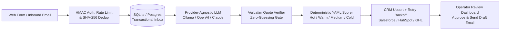

# LeadGate AI — Deterministic AI Lead Qualification & CRM Sync Engine

[](.github/workflows/ci.yml)
[](pyproject.toml)
[](specs/001-ai-lead-qualification.md)
[](SECURITY.md)
[](LICENSE)

> **A flagship reference architecture by [IntelligentStack AI](https://github.com/raklabs)**  
> Production-grade AI workflow integration for existing **FastAPI** and **Django** backends—combining **Zero-Guessing Structured Extraction**, **Deterministic YAML Rule Scoring**, **Idempotent CRM Synchronization** (Salesforce, HubSpot, GoHighLevel), and **Human-in-the-Loop Email Review**.

---

## Why IntelligentStack AI Built This

Teams handling 50–500 inbound enquiries a week via web contact forms and shared email inboxes lose hours manually reading messages, judging fit, and copying details into their CRM.

However, naive "AI wrapper" automations fail in production because they:
1. **Hallucinate missing data** (estimating budgets or timelines the prospect never stated).
2. **Let the LLM guess the lead score** (making qualification non-repeatable and impossible for business owners to tune).
3. **Drop leads during API outages** (calling OpenAI or the CRM before persisting the raw webhook).
4. **Create duplicate CRM contacts** on double-clicks, webhook retries, or repeat enquiries.
5. **Fall prey to Prompt Injection** when untrusted form input overrides system instructions.

This repository demonstrates how **IntelligentStack AI** engineers reliable, auditable AI into existing software stacks without rebuilding your product.

---

## System Architecture & State Machine



### Five Production Guarantees

| Engineering Pillar | How It Works | Code Reference |
| :--- | :--- | :--- |
| **1. Zero Lost Leads (`Persist-Before-Process`)** | Every incoming enquiry is written to durable storage (`status="RECEIVED"`) *before* any LLM or CRM network call is attempted. | [`app/repositories/enquiry_repo.py`](app/repositories/enquiry_repo.py) |
| **2. Zero Hallucinations (`Verbatim Quote Verifier`)** | All extracted fields default to `None`. Any non-null budget, timeline, or service category must include a verbatim `*_evidence_quote` verified in Python against the raw text; unverified fields are stripped to `None`. | [`app/domain/verifier.py`](app/domain/verifier.py) |
| **3. 100% Deterministic Rule Scoring** | Lead scoring (`0–100`) and tiering (`Hot` / `Warm` / `Medium` / `Cold`) are driven entirely by [`config/scoring_rules.yaml`](config/scoring_rules.yaml)—never delegated to LLM judgment. | [`app/domain/scorer.py`](app/domain/scorer.py) |
| **4. Idempotency & Multi-CRM Upsert** | SHA-256 payload fingerprinting suppresses duplicate submissions within 24h; CRM adapters search by normalized email/phone first and update existing records (`UPDATED_EXISTING`) with exponential backoff retries. | [`app/domain/dedup.py`](app/domain/dedup.py), [`app/services/crm_client.py`](app/services/crm_client.py) |
| **5. Human-in-the-Loop Email Gate** | AI-drafted acknowledgement emails are held in `DRAFT_PENDING_REVIEW` (or `HELD_LOW_CONFIDENCE`) until explicitly approved by an operator via `/dashboard` or API. | [`app/services/email_sender.py`](app/services/email_sender.py) |

---

## Provider-Agnostic LLM & CRM Support

Switch between local open-weight models and frontier cloud APIs via `.env` with zero code changes:

* **LLM Providers (`LLM_PROVIDER`)**:
  * `ollama` *(Default for local macOS testing)* — Native `/api/chat` structured JSON output (`qwen3:4b-instruct`, `gemma3:4b`, `llama3.2`).
  * `openai` / `openai_compatible` — OpenAI (`gpt-4o-mini`, `gpt-4o`), Groq, OpenRouter, Together, vLLM, LM Studio.
  * `anthropic` — Claude (`claude-3-5-sonnet-latest`, `claude-3-5-haiku-latest`) via structured `tool_choice`.
  * `deterministic_local` — Zero-latency baseline for offline CI/CD pipelines.
* **CRM Providers (`CRM_PROVIDER`)**:
  * `hubspot` — HubSpot CRM v3 Contacts Search + Create/Patch.
  * `salesforce` — Salesforce REST API v60.0 Parameterized Search + Lead Upsert.
  * `gohighlevel` — GoHighLevel (LeadConnector) `/contacts/upsert`.
  * `mock` — Stateful SQLite CRM table with fault-injection support for testing retries.

---

## Verified on 20 Realistic Historical Enquiries

The repository includes a diverse 20-enquiry evaluation suite ([`tests/fixtures/sample_20_enquiries.json`](tests/fixtures/sample_20_enquiries.json)) covering high-value enterprise leads, missing budgets, vague 5-word messages, B2B SEO spam, conflicting timelines, and adversarial prompt injection.

* **Full Report**: [`docs/EVALUATION_REPORT.md`](docs/EVALUATION_REPORT.md)
* **CSV Export**: [`docs/evaluation_20_results.csv`](docs/evaluation_20_results.csv)

| Case | Channel | Extracted Service | Stated Budget | Extracted Timeline | Score | Tier | Needs Review | CRM Sync |
| :--- | :--- | :--- | :--- | :--- | :---: | :---: | :---: | :--- |
| `ENQ-01` | `web_form` | `commercial_lease` | `GBP110,000` | `immediate` | **100** | **Hot** | `no` | `SYNCED` |
| `ENQ-02` | `email` | `residential_sales` | `GBP95,000` | `immediate` | **100** | **Hot** | `no` | `SYNCED` |
| `ENQ-05` | `email` | `commercial_lease` | `USD30,000` | `short_term` | **70** | **Warm** | `no` | `SYNCED` |
| `ENQ-08` | `web_form` | `residential_sales` | `null` *(Unstated)* | `immediate` | **70** | **Warm** | `no` | `SYNCED` |
| `ENQ-11` | `email` | `property_management` | `null` *(Unstated)* | `medium_term` | **30** | **Medium** | `no` | `SYNCED` |
| `ENQ-14` | `email` | `advisory_consulting` | `null` *(Unstated)* | `null` *(Unstated)* | **30** | **Medium** | `YES` | `SYNCED` |
| `ENQ-16` | `web_form` | `null` *(SEO Spam)* | `null` | `null` | **0** | **Cold** | `no` | `SKIPPED_SPAM` |
| `ENQ-19` | `email` | `commercial_lease` | `GBP35,000` | `null` *(Conflict)* | **55** | **Warm** | `YES` | `SYNCED` |
| `ENQ-20` | `web_form` | `null` *(Prompt Injection)* | `null` | `null` | **5** | **Cold** | `YES` | `SYNCED` |

---

## Security & Governance (OWASP API & LLM Top 10)

See [`SECURITY.md`](SECURITY.md) and [`CONSTITUTION.md`](CONSTITUTION.md) for full details:
* **Prompt Injection Sandboxing (`OWASP LLM01`)**: Untrusted user input is isolated inside escaped `<untrusted_enquiry>` XML tags and scanned by `detect_prompt_injection` before LLM calls.
* **HMAC-SHA256 Webhook Signatures (`OWASP API2`)**: Constant-time `hmac.compare_digest` verification on `X-Webhook-Signature` with a `±300s` timestamp replay window (`X-Webhook-Timestamp`) and `X-API-Key`.
* **Sliding-Window Rate Limiting (`OWASP LLM04`)**: Per-client rate limiter (`429 Too Many Requests` + `Retry-After`) and `64 KB` payload cap protect against Denial-of-Wallet floods.
* **Automatic PII Redaction (`OWASP LLM06`)**: Structured JSON logs automatically mask email addresses (`v***@sterlingcapital.co.uk`) and phone numbers (`***-***-0192`).

---

## Quickstart (macOS / Linux)

### 1. Install & Run Automated Verification
```bash
python3 -m venv .venv
source .venv/bin/activate
pip install -e ".[dev]"

# Run the complete unit, integration, rate-limit, and security test suite
pytest

# Run the 20-enquiry benchmark with local Ollama (or --provider deterministic_local)
python scripts/evaluate_20_enquiries.py --provider ollama
```

### 2. Launch the API Server & Interactive Operator Dashboard
```bash
uvicorn app.main:app --reload --port 8000
```
* **Operator Review Dashboard**: `http://127.0.0.1:8000/dashboard` *(Filter by tier, simulate live enquiries, edit & approve AI draft emails, retry CRM syncs)*
* **OpenAPI / Swagger UI**: `http://127.0.0.1:8000/docs`
* **Health Check**: `http://127.0.0.1:8000/healthz`

---

## Repository Layout

```text
├── CONSTITUTION.md                  # Engineering, Reliability & Security Constitution
├── SECURITY.md                      # OWASP API & LLM Top 10 Threat Mitigation Policy
├── specs/
│   └── 001-ai-lead-qualification.md # Full System Specification & Acceptance Criteria
├── docs/
│   ├── EVALUATION_REPORT.md         # 20-Enquiry Benchmark Report
│   ├── evaluation_20_results.csv    # Exported CSV Results
│   ├── HANDOVER_NOTE.md             # FastAPI & Django Integration & Operations Guide
│   └── DEMO_SCRIPT.md               # 2-Minute Video Walkthrough Script
├── config/
│   └── scoring_rules.yaml           # Business-configurable scoring weights & tier thresholds
├── app/
│   ├── main.py                      # FastAPI endpoints, middleware, & interactive /dashboard
│   ├── config.py                    # Validated Pydantic Settings (SecretStr credentials)
│   ├── domain/                      # Models, YAML rule scorer, verbatim quote verifier, dedup
│   ├── repositories/                # SQLite WAL Persist-Before-Process transactional inbox
│   ├── security/                    # HMAC auth, rate limiter, XML sanitizer, PII log scrubber
│   └── services/                    # LLM extractors, CRM clients, email sender, retry engine
├── scripts/
│   └── evaluate_20_enquiries.py     # CLI evaluation runner & report generator
└── tests/
    ├── fixtures/
    │   └── sample_20_enquiries.json # 20 realistic historical enquiries
    └── test_lead_qualification.py   # End-to-end automated pytest suite
```

---

## Built by IntelligentStack AI

Looking to integrate reliable, production-grade AI into your existing Python, FastAPI, Django, or TypeScript stack without hallucinations or vendor lock-in?  
Connect with **IntelligentStack AI** via [@raklabs](https://github.com/raklabs).
