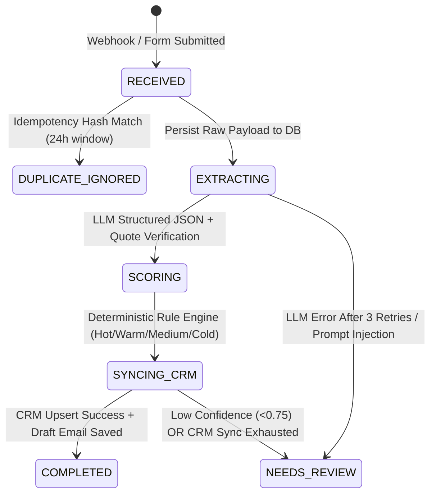

# Spec 001: AI Lead Qualification & CRM Sync Pipeline

- **Status**: Approved · 2026-03-11
- **Phase**: Phase 1 (Core Ingestion, Provider-Agnostic AI Extraction, Deterministic Scoring, CRM Sync, Email Draft Review)
- **Target Stack**: Python 3.12+, FastAPI, Pydantic v2, SQLite (WAL mode for local/dev, PostgreSQL-compatible SQL), Provider-Agnostic LLM Structured Outputs (`ollama` for local testing, `openai`, `openai_compatible`, `anthropic`), HubSpot / GoHighLevel / Mock CRM REST Adapters

---

## 1. Overview & Problem Statement

The existing web application receives 50–100 enquiries per week across two channels:
1. **Web Contact Form** (structured contact metadata + free-text message)
2. **Inbound Email Inbox** (subject, sender address, raw email body)

Currently, team members manually read each enquiry, judge fit, and copy-paste contact details into the CRM. This causes slow response times, inconsistent lead qualification, and manual data entry errors.

### 1.1 Phase 1 Objectives
1. **Persist every incoming enquiry immediately** before external API calls so zero leads are lost during outages.
2. **Extract structured attributes** (`contact_name`, `email`, `phone`, `company`, `service_or_property_type`, `budget_min`, `budget_max`, `budget_currency`, `timeline`, `urgency`, `location`, `summary`) via LLM Structured JSON Output with a strict **Zero-Guessing Policy**.
3. **Verify no hallucinated facts** by requiring verbatim evidence quotes for extracted commercial attributes and verifying them in Python.
4. **Score and tag leads (`Hot` / `Warm` / `Medium` / `Cold`)** using a **configurable, deterministic Python rule engine** (`config/scoring_rules.yaml`).
5. **Sync qualified leads to the CRM** (HubSpot / GoHighLevel / Salesforce / Local Mock) via REST API with retry/backoff and contact deduplication (upsert by email/phone).
6. **Flag `needs_review = True`** when AI confidence is below threshold, critical fields are missing/contradictory, prompt injection is suspected, or CRM sync fails after retries.
7. **Generate a short acknowledgement email draft** queued for human review before sending.

### 1.2 Non-Goals (Phase 1)
- Autonomous multi-turn email auto-responder without human review.
- Replacing the existing web app frontend or migrating the existing CRM.
- Allowing the LLM to invent or adjust scoring weights.

---

## 2. System Architecture & Lifecycle State Machine



### 2.1 Processing Pipeline Steps
1. **Ingest & Authenticate**:
   - Validate HMAC-SHA256 webhook signature (`X-Webhook-Signature`) or API key (`X-API-Key`).
   - Enforce payload size limit (`<= 64 KB`) and sanitize control characters.
2. **Deduplicate & Persist (Transactional Inbox)**:
   - Normalize email (`lowercase`, trimmed), phone (`E.164` / digits), and message body (collapsed whitespace).
   - Compute `dedup_hash = sha256(f"{source}:{norm_email}:{norm_phone}:{norm_body}")`.
   - If `dedup_hash` exists within the configurable deduplication window (default 24 hours) or matches `external_id`, return existing record with `is_duplicate = True`.
   - Otherwise, insert row into `enquiries` table with status `RECEIVED`.
3. **Structured AI Extraction + Draft Generation (Provider-Agnostic)**:
   - Call configured LLM provider via unified `LeadExtractorProtocol`:
     - `ollama` (default for local macOS testing via `http://127.0.0.1:11434/api/chat` with native JSON Schema `format` enforcement, e.g. `qwen3:4b-instruct` or `gemma3:4b`)
     - `openai` / `openai_compatible` (OpenAI, OpenRouter, Groq, Together, vLLM, LM Studio, Azure OpenAI via `/v1/chat/completions`)
     - `anthropic` (Claude 3.5 Sonnet / Haiku via `/v1/messages` structured tool-choice)
     - `deterministic_local` (zero-latency rule/regex fallback for offline CI)
   - Run **Evidence Quote Verifier**: If the LLM extracts a `budget_min`/`budget_max`, `timeline`, or `service_or_property_type` whose `evidence_quote` does not appear in the raw text, strip the unverified field to `None` and lower confidence.
4. **Deterministic Rule-Based Scoring**:
   - Load rules from `config/scoring_rules.yaml`.
   - Evaluate points across dimensions: `budget`, `timeline`, `urgency`, `service_or_property_type`, `completeness`.
   - Map total score (`0–100`) to tier:
     - `Hot`: `score >= 75`
     - `Warm`: `50 <= score < 75`
     - `Medium`: `25 <= score < 50`
     - `Cold`: `score < 25`
5. **Review Flag Evaluation (`needs_review`)**:
   - Set `needs_review = True` (with explicit `review_reasons: list[str]`) if ANY of the following hold:
     - `extraction_confidence < rules.min_confidence_threshold` (default `0.75`)
     - Missing both `email` and `phone` (uncontactable lead)
     - Unverified evidence quote stripped by the verifier
     - Prompt injection / adversarial pattern detected in raw message
     - Ambiguous or conflicting commercial terms flagged by extractor
     - CRM sync failed after maximum retries
6. **CRM Upsert with Exponential Backoff**:
   - Search CRM by email (fallback to phone).
   - If contact exists $\rightarrow$ `PATCH` contact properties (score, tier, AI summary, review flag) and attach enquiry note.
   - If contact does not exist $\rightarrow$ `POST` new contact/lead with full metadata.
   - Retry transient HTTP errors (`429`, `500`, `502`, `503`, `504`, network timeout) up to 3 times with exponential backoff and jitter.

---

## 3. Data Contracts & Schemas

### 3.1 Inbound Enquiry Payload (`EnquiryCreateRequest`)

```python
class EnquirySource(StrEnum):
    WEB_FORM = "web_form"
    EMAIL = "email"

class EnquiryCreateRequest(BaseModel):
    model_config = ConfigDict(extra="forbid", str_strip_whitespace=True)

    external_id: str | None = Field(default=None, max_length=128)
    source: EnquirySource
    sender_name: str | None = Field(default=None, max_length=200)
    sender_email: str | None = Field(default=None, max_length=254)
    sender_phone: str | None = Field(default=None, max_length=64)
    subject: str | None = Field(default=None, max_length=300)
    message_body: str = Field(..., min_length=1, max_length=15000)
    received_at: datetime | None = None
```

### 3.2 AI Structured Extraction Schema (`ExtractedEnquiryData`)

> **Zero-Guessing Rule**: Every commercial and contact field is `Optional` (`None` by default). The LLM is prohibited from guessing or extrapolating values not explicitly written in the enquiry.

```python
class ServiceCategory(StrEnum):
    RESIDENTIAL_SALES = "residential_sales"
    COMMERCIAL_LEASE = "commercial_lease"
    PROPERTY_MANAGEMENT = "property_management"
    ADVISORY_CONSULTING = "advisory_consulting"
    RENOVATION_FITOUT = "renovation_fitout"
    OTHER = "other"

class TimelineBucket(StrEnum):
    IMMEDIATE = "immediate"           # < 2 weeks / ASAP
    SHORT_TERM = "short_term"         # 2 weeks - 3 months
    MEDIUM_TERM = "medium_term"       # 3 - 6 months
    LONG_TERM = "long_term"           # > 6 months
    EXPLORATORY = "exploratory"       # "just browsing" / no timeline

class UrgencyLevel(StrEnum):
    HIGH = "high"
    MEDIUM = "medium"
    LOW = "low"

class ExtractedEnquiryData(BaseModel):
    model_config = ConfigDict(extra="forbid")

    contact_name: str | None = None
    contact_email: str | None = None
    contact_phone: str | None = None
    company_name: str | None = None

    service_or_property_type: ServiceCategory | None = None
    service_evidence_quote: str | None = None

    budget_min: float | None = Field(default=None, ge=0)
    budget_max: float | None = Field(default=None, ge=0)
    budget_currency: str | None = Field(default=None, max_length=8)
    budget_evidence_quote: str | None = None

    timeline: TimelineBucket | None = None
    timeline_evidence_quote: str | None = None

    urgency: UrgencyLevel | None = None
    location: str | None = None

    ai_summary: str = Field(..., max_length=600)
    extraction_confidence: float = Field(..., ge=0.0, le=1.0)
    ambiguities_or_missing_notes: list[str] = Field(default_factory=list)
    is_spam_or_irrelevant: bool = False

    draft_acknowledgement_subject: str = Field(..., max_length=200)
    draft_acknowledgement_body: str = Field(..., max_length=2500)
```

---

## 4. Configurable Rule-Based Scoring Engine (`config/scoring_rules.yaml`)

Scoring is strictly deterministic and defined in YAML so business owners can adjust weights without modifying Python code or prompts:

| Dimension | Condition | Default Points |
| :--- | :--- | :--- |
| **Service / Property Type** | High-value core target (`commercial_lease`, `residential_sales`, `advisory_consulting`) | `+25` |
| | Secondary target (`property_management`, `renovation_fitout`) | `+15` |
| | `other` | `+5` |
| **Budget** | `>= 50,000` | `+30` |
| | `15,000 – 49,999` | `+20` |
| | `5,000 – 14,999` | `+10` |
| | `< 5,000` (explicitly stated low budget) | `+0` |
| | Not stated (`None`) | `+0` (unverified/missing budget receives 0 points) |
| **Timeline** | `immediate` | `+20` |
| | `short_term` | `+15` |
| | `medium_term` | `+10` |
| | `long_term` / `exploratory` | `+2` |
| **Urgency** | `high` | `+15` |
| | `medium` | `+8` |
| | `low` | `+2` |
| **Contact Completeness** | Both `email` AND `phone` present | `+10` |
| | Either `email` OR `phone` present | `+5` |
| **Spam / Non-Lead Penalty** | `is_spam_or_irrelevant == True` | Forces score to `0` (`Cold`) |

### Tier Thresholds
- **`Hot`**: `>= 75` points
- **`Warm`**: `50 – 74` points
- **`Medium`**: `25 – 49` points
- **`Cold`**: `< 25` points

---

## 5. Security Controls Specification

| Threat / Risk | Mitigation Control | Implementation Location |
| :--- | :--- | :--- |
| **Unauthenticated Webhook Spoofing** | HMAC-SHA256 verification on `X-Webhook-Signature` with timestamp replay protection (`X-Webhook-Timestamp` within 300s) + API Key auth (`X-API-Key`). | `app/security/auth.py` |
| **Prompt Injection / Score Manipulation** | XML input sandboxing (`<untrusted_enquiry>`), deterministic regex/heuristic injection scanner, verbatim quote verification in Python, and zero LLM control over scoring. | `app/security/sanitizer.py`, `app/domain/verifier.py` |
| **PII Leakage in Application Logs** | Custom structured logging filter that masks emails (`r***@domain.com`) and phone numbers (`***-***-1234`). | `app/security/logging.py` |
| **Denial of Wallet / Payload Flood** | Request body cap (`64 KB`), rate limiter middleware, and deduplication hash check **before** calling LLM APIs. | `app/api/middleware.py`, `app/domain/dedup.py` |
| **Accidental Unreviewed External Emails** | Draft emails are created in `DRAFT_PENDING_REVIEW` status; sending requires an explicit authenticated `POST /api/v1/enquiries/{id}/approve-email` action. | `app/services/pipeline.py` |

---

## 6. API Surface

| Method | Path | Auth | Description |
| :--- | :--- | :--- | :--- |
| `POST` | `/api/v1/enquiries/webhook` | HMAC or API Key | Ingests web form or email enquiry, runs pipeline, syncs CRM, returns full result. |
| `GET` | `/api/v1/enquiries` | API Key | Lists processed enquiries with filter by `tier` (`Hot`/`Warm`/`Medium`/`Cold`) and `needs_review`. |
| `GET` | `/api/v1/enquiries/{enquiry_id}` | API Key | Returns detailed breakdown: raw input, extracted JSON, evidence quotes, score breakdown, CRM sync logs, and email draft. |
| `POST` | `/api/v1/enquiries/{enquiry_id}/approve-email` | API Key | Approves (and optionally edits) the drafted acknowledgement email for sending. |
| `POST` | `/api/v1/enquiries/{enquiry_id}/retry-sync` | API Key | Re-runs CRM synchronization for a lead that previously failed sync. |
| `GET` | `/dashboard` | Local UI | Interactive operator review dashboard for inspecting leads, scores, and approving draft emails. |
| `GET` | `/healthz` | Public | Health check reporting DB connectivity, active LLM provider, and CRM configuration status. |

---

## 7. Acceptance Criteria & 20-Enquiry Evaluation Suite

1. **AC-1 (No Guessing)**: On enquiries missing budget, timeline, or phone number, the extracted JSON fields MUST be `null` (`None`), never estimated.
2. **AC-2 (Deterministic Scoring)**: Changing `config/scoring_rules.yaml` thresholds immediately changes lead tiers (`Hot`/`Warm`/`Medium`/`Cold`) deterministically without LLM calls.
3. **AC-3 (Idempotency)**: Submitting the same enquiry twice (or with the same `external_id`) returns `is_duplicate: true` on the second request, makes zero additional LLM calls, and creates only one CRM contact.
4. **AC-4 (Resilience & Retries)**: When the CRM API returns transient `503`/`429` errors on the first 2 attempts and `200 OK` on the 3rd, the lead succeeds and logs 3 attempts. When all 3 attempts fail, the enquiry remains safely saved in the database with `crm_sync_status = "FAILED"` and `needs_review = True`.
5. **AC-5 (Low Confidence & Injection Review Flag)**: Vague enquiries or prompt-injection attempts automatically receive `needs_review = True` with human-readable `review_reasons`.
6. **AC-6 (20-Enquiry Benchmark)**: `scripts/evaluate_20_enquiries.py` processes 20 diverse realistic enquiries and achieves 100% schema validity, 0 hallucinated fields, and 100% expected tier accuracy.
